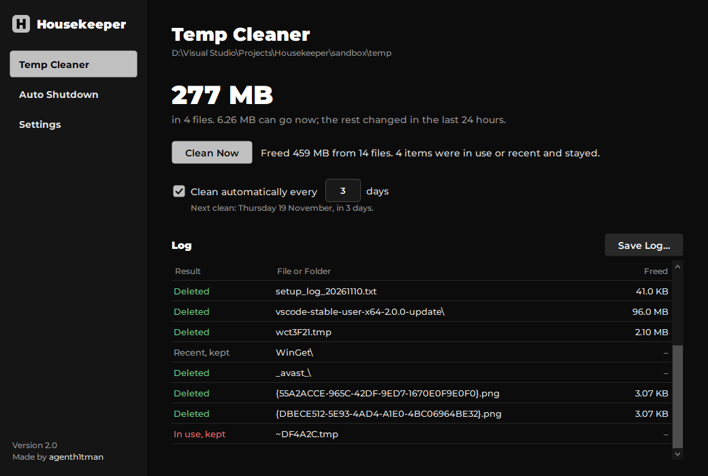
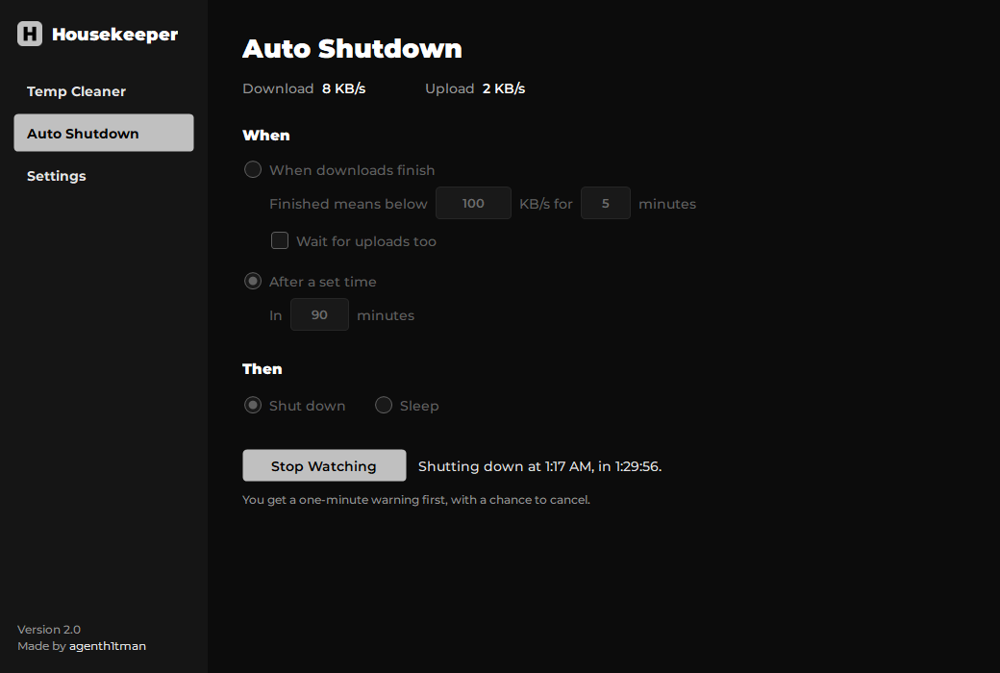
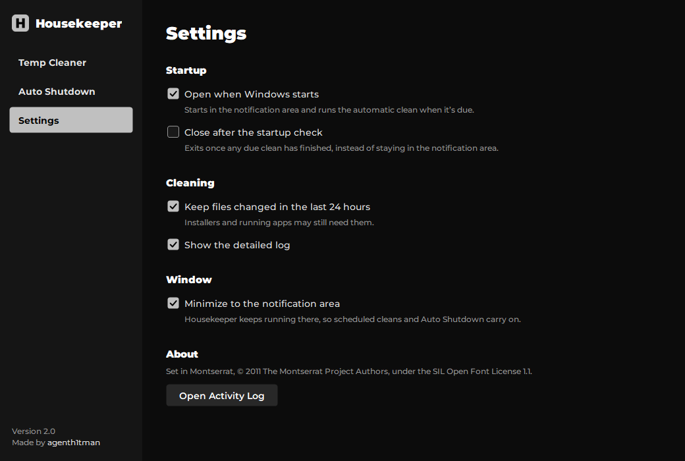

# Housekeeper

A small Windows tray app that keeps your temp folder clean and can turn the PC off once your
downloads finish.



## Features

**Temp Cleaner**
- Shows how much is sitting in your temp folder (`%LOCALAPPDATA%\Temp`) and empties it in one click.
- Leaves alone anything that's in use, and by default anything changed in the last 24 hours, so
  installers and apps that are still running don't break.
- Logs every file and folder it touched: deleted, partly deleted, in use or kept. You can save
  the log as a text file.
- Cleans automatically every few days. The schedule counts calendar days, so days the PC was off
  still count.

**Auto Shutdown**
- Shuts down or sleeps the PC once your downloads (and, if you like, uploads) stay below a speed
  you choose for a few minutes. Start it before you go to bed and leave the download running.
- Or simply shuts down or sleeps after a set number of minutes.
- Always gives you a one-minute warning you can cancel, and keeps Windows from falling asleep
  on its own while it waits.

**Runs quietly**
- Can open when Windows starts: it sits in the notification area, runs the automatic clean if
  it's due, and can close itself again afterwards.
- One copy at a time. Opening it again brings the running copy to the front.

| Auto Shutdown | Settings |
| --- | --- |
|  |  |

## Download

Get `Housekeeper.zip` from the [Releases](../../releases) page, unzip it anywhere
(for example `C:\Tools\Housekeeper`) and run `Housekeeper.exe`. You don't need to install .NET.

Needs 64-bit Windows 10 or 11.

The exe isn't code-signed, so the first time you run it Windows SmartScreen may say it
"protected your PC". Choose **More info → Run anyway**.

## Using it

- **Ctrl+1**, **Ctrl+2** and **Ctrl+3** switch between the pages. **F5** measures the temp folder again.
- Minimizing hides the window in the notification area (you can turn this off in Settings).
  Click the tray icon to bring it back, or right-click it for **Clean Temp Folder Now** and **Exit**.
- Everything Housekeeper does (startups, automatic cleans, Auto Shutdown, errors) goes into an
  activity log: **Settings → Open Activity Log**.

### What gets deleted

Only the contents of your own temp folder, `%LOCALAPPDATA%\Temp`. Housekeeper never follows
links or junctions out of it, and refuses to run if that path ever points at a drive root or a
profile folder. Files that are locked by a running program are skipped, never forced.

## Building from source

You need the [.NET 10 SDK](https://dotnet.microsoft.com/download).

```bash
dotnet build
```

```bash
dotnet run
```

To make the same single `Housekeeper.exe` as the release (self-contained, written to `bin\publish`):

```bash
dotnet publish -p:PublishProfile=FolderProfile
```

### Sandbox mode

```bash
dotnet run -- --sandbox sandbox
```

Keeps settings and a stand-in temp folder inside the `sandbox` folder, and never touches the
registry or shuts the PC down; it writes what it would have done to the activity log instead.
The screenshots above were taken this way.

## Where things live

| What | Where |
| --- | --- |
| Settings | `%LOCALAPPDATA%\Housekeeper\settings.json` |
| Activity log | `%LOCALAPPDATA%\Housekeeper\activity.log` |
| Fonts, unpacked from the exe | `%LOCALAPPDATA%\Housekeeper\Fonts` |
| Startup entry | `HKCU\Software\Microsoft\Windows\CurrentVersion\Run`, value `Housekeeper` |

To uninstall, untick **Open when Windows starts** in Settings, close Housekeeper, then delete its
folder and `%LOCALAPPDATA%\Housekeeper`.

## License

Housekeeper is released under the [MIT License](LICENSE).

The interface is set in [Montserrat](https://github.com/JulietaUla/Montserrat), © 2011 The
Montserrat Project Authors, under the [SIL Open Font License 1.1](Assets/Fonts/OFL.txt). The
copies built into the app are renamed internally to "HK Montserrat" so they never clash with a
Montserrat installed on the PC; nothing else in them is changed. The app icon was drawn for this
project.

Made by [agenth1tman](https://github.com/agenth1tman).
